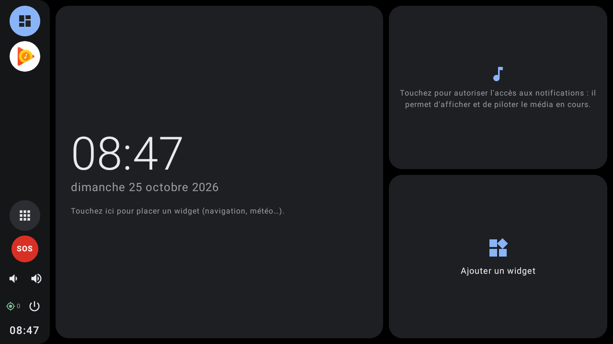
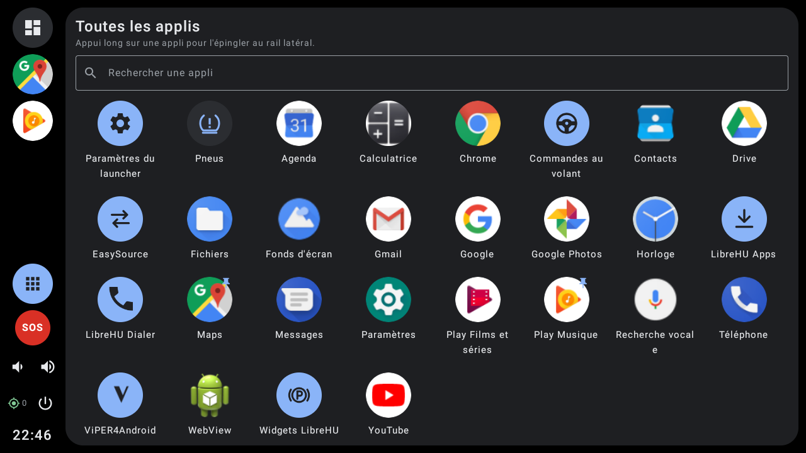
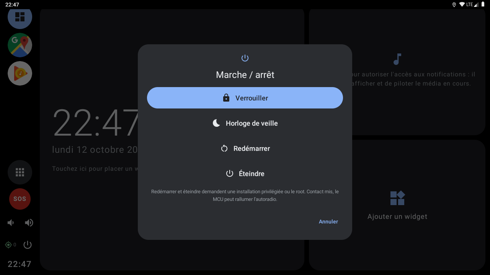
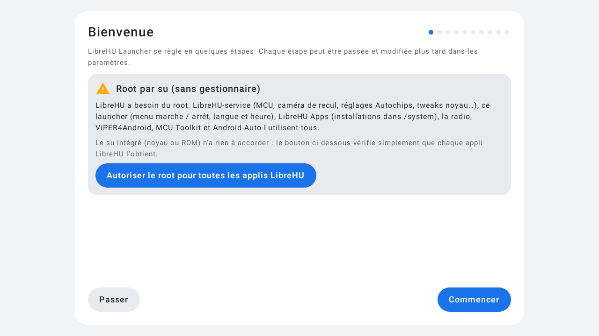

# LibreHU Launcher

Lanceur (écran d'accueil) pour autoradios Android, inspiré des interfaces voiture à tableau de bord : thème
sombre, grandes cibles tactiles, rail de raccourcis à gauche, cartes arrondies. Projet indépendant, sans lien avec
Google ni Android Auto, et sans aucun de leurs éléments graphiques.

- **Rail** : tableau de bord, applis épinglées (par défaut : navigation, radio, musique, téléphone), toutes les
  applis, volume − / +, heure.
- **Tableau de bord** : grand emplacement de widget (horloge et date tant qu'il est vide), carte « en cours de
  lecture » (n'importe quelle app avec une `MediaSession` : radio, musique, projection…) avec précédent / lecture /
  suivant, second emplacement de widget avec ajout du widget de [LibreHU FM](https://github.com/LibreHU/LibreHU-FM-App)
  en un geste. Le launcher signale au service LibreHU quand le tableau de bord est affiché
  (`org.librehu.action.HOME_VISIBLE`). Le widget « Vue arrière » de LibreHU-service est affiché **en vrai flux** :
  le launcher pose sa propre vue vidéo sur le widget et le service y fait dessiner la caméra directement (pleine
  cadence, `ui/RearLive.kt`) ; un toucher ouvre ou ferme la vue arrière plein écran.
- **Android Auto** ([Open Headunit](https://github.com/andreknieriem/headunit-revived) ou son fork LibreHU) : pendant
  une session, carte sur le tableau de bord (connexion, à l'écran, USB / Wi-Fi ; toucher = afficher la projection,
  bouton déconnecter) et, avec Open Headunit LibreHU, **la prochaine manœuvre de la navigation** (direction,
  distance, route, heure d'arrivée ; diffusion `NAVIGATION_UPDATE` réservée aux applis signées avec la clé LibreHU).
  **Image d'Android Auto sur le tableau de bord** (expérimental, Réglages → apparence, désactivé par défaut) :
  pendant une projection, la carte montre l'image en direct et tactile (boutons plein écran et déconnecter). La
  surface de la carte est confiée au décodeur d'Open Headunit LibreHU (`LibreHuVideoService`, permission signature
  `org.librehu.headunit.permission.CONFIGURE`) tant que son écran de projection n'est pas affiché.
  Réglages d'Android Auto : LibreHU-service, onglet Android Auto.
- **Toutes les applis** : grille ; appui long pour épingler, retirer ou réordonner dans le rail.
- **Pneus (TPMS)** : récepteur TPMS USB (les modèles vendus avec les apps « USB TPMS ») lu directement, carte
  sur le tableau de bord, écran détaillé (pression, température, batterie, ID), appairage, permutation, seuils et
  notification d'alerte, **widget « Pneus »** (4 pneus autour de la voiture, rouge en alerte, ouvre l'écran TPMS)
  utilisable dans les emplacements du launcher ou sur n'importe quel autre écran d'accueil. Protocole :
  [docs/tpms.md](docs/tpms.md).
- **Météo** (Paramètres → Conduite, désactivée par défaut) : température, temps, ressenti, min / max du jour à la
  position GPS de l'autoradio (arrondie à 0,01°, environ 1 km) par **Open-Meteo** (gratuit sans clé pour un usage non
  commercial, ≤ 10 000 appels / jour, données CC BY 4.0), actualisée toutes les 15 min à 2 h ou après 5 km ;
  **widget « Météo »** (toucher = actualiser) et symbole + température **dans la barre** près de l'heure (option).
  `weather/WeatherRepo.kt`.
- **Limitation de vitesse** (Paramètres → Conduite, désactivée par défaut) : vitesse maximale de la route lue dans
  **OpenStreetMap** (`maxspeed`, `maxspeed:forward` / `:backward` selon le sens, valeurs implicites `FR:urban` 50,
  `FR:rural` 80, `FR:motorway` 130, zones 30…) par l'API **Overpass** : routes à 500 m autour chargées d'un coup,
  rechargées 300 m avant d'en sortir (au plus toutes les 10 s, attente de 60 s si le serveur est saturé) ; la voiture
  est rattachée à la route la plus proche allant dans son sens (cap GPS), une autre route doit gagner deux fois de
  suite. **Alerte de dépassement** : marge en km/h et/ou en %, durée minimale, 6 sons au choix (bip, double, triple,
  carillon, alarme, son de notification) ou aucun, volume, une fois ou répétée, signal au changement de limitation,
  vitesse GPS ou OBD. **Widget « Limitation »** (panneau, rouge en dépassement), **mode « avec la limitation »** du
  widget Vitesse, et panneau **dans la barre** (option). Serveur Overpass au choix. Alerte de limitation seulement :
  **aucun radar** (signaler leur position est interdit en France, art. R413-15 du Code de la route). Données OSM
  participatives : les panneaux font foi. `speed/SpeedLimits.kt`, `speed/SpeedLimitManager.kt`.
- **Android Auto : vidéo basse latence** (Paramètres, à côté de la carte Android Auto) : réglage
  `debug-video-low-latency` d'Open Headunit LibreHU, lu et écrit par ses commandes de réglage (signature LibreHU) :
  `vdec-lowlatency` sur le décodeur MediaTek, en plein écran comme dans la carte (`data/AndroidAutoLink.kt`).
- **Appli téléphone LibreHU** : la page **Conduite** (météo, limitation de vitesse : interrupteurs, marge, son, essai)
  est aussi réglable depuis le téléphone, par LibreHU-service (fournisseur `org.librehu.launcher.bridge`, permission de
  signature `org.librehu.permission.BRIDGE`, `bridge/BridgeProvider.kt`).
- **OBD plein écran** (tiroir → OBD, ou l'action `org.librehu.launcher.action.SHOW_OBD`), comme l'écran Pneus : à
  gauche la **batterie de la voiture** (tension, charge estimée moteur arrêté avec sa barre, « en charge » / « ne
  charge pas » / « surtension » moteur tournant), à droite vitesse et régime en grand puis toutes les valeurs lues
  par l'adaptateur ELM327 de LibreHU-service (standard et **valeurs constructeur** de la voiture choisie, base
  ddt4all). Données : broadcast `org.librehu.action.OBD` du service (`obd/ObdLive.kt`), rien à interroger ; adaptateur,
  valeurs, voiture et alarmes batterie se règlent dans LibreHU-service → OBD (bouton « Réglages OBD »).
- **Carte média** : titre, pochette, ⏮ ⏯ ⏭ et **barre de progression** (temps écoulé / durée, déplaçable quand
  l'appli accepte l'avance rapide). **Musique Bluetooth** : l'AVRCP n'a pas de « aller à la position », seulement
  avance / retour rapides : le lanceur appuie dessus pas à pas en relisant la position, jusqu'à quelques secondes de
  la cible (approximatif ; s'arrête si le lecteur du téléphone les ignore). **LibreHU Disc** : bouton ⏏ **Éjecter**
  en plus (action `org.librehu.disc.action.EJECT` de sa session : arrête la lecture et ouvre le tiroir).
- **Menu power** : verrouiller, horloge de veille, redémarrer, éteindre, redémarrer par la MCU ; boutons centrés.
- **Fluidité** : fonds animés redessinés à 20 i/s (vagues 30, spectre 30) sans recomposer l'écran, arrêtés quand le
  lanceur n'est pas visible ; APK publié en build *release* (non débogable, compilé entièrement par Android).
- **Pages d'accueil** (Paramètres → apparence, 1 à 4) : on glisse sur le côté du tableau de bord vers des pages de
  quatre widgets chacune (points sous les pages).
- **Fond d'écran internet** : image du jour de **Bing** (pays et langue au choix, ou ceux de l'appareil), de
  **Wikimedia Commons**, ou **photo au hasard** (Lorem Picsum, photos Unsplash) ; nouvelle image chaque jour, toutes les
  6 heures ou à chaque démarrage, et bouton « Nouvelle image maintenant ». Téléchargée seulement avec du réseau
  (environ 0,5 Mo), la dernière reste sans réseau ; titre et crédit de l'image en petit dans un coin (désactivable).
- **Style** (Paramètres → Personnalisation) : **Moderne** ou **rétro** — **VFD ambre** (afficheur fluorescent des
  autoradios des années 80), **LCD vert**, **cassette** (tons chauds des années 70) ; chaque style a ses couleurs en
  clair et en sombre (jour / nuit et phares comme d'habitude), police à chasse fixe partout, et la nuit **lignes de
  balayage** sur tout l'écran pour l'ambre et le vert (un dessin en cache, sans animation : pas de coût en continu).
- **Fonds d'écran** (Paramètres) : aucun, animations intégrées à la couleur d'accent (aurore, étoiles, vagues),
  image fixe, **GIF / WebP animé** (`AnimatedImageDrawable`), **vidéo** MP4 en boucle et muette (ne prend pas le
  focus audio), ou **fond Android / live wallpaper** affiché derrière le launcher (`FLAG_SHOW_WALLPAPER`). Les
  animations se mettent en pause dès que le launcher n'est plus au premier plan.
- **Fond « Spectre »** : vagues lumineuses du fond animé « Music visualization » d'AOSP (Apache 2.0), dans l'esprit de
  [Neospectro](https://github.com/danielnavarrowo/Neospectro) (réécrit en OpenGL ES 2, pas de code repris : le dépôt
  Neospectro n'a pas de licence). 7 palettes dont la couleur d'accent ; option **« suivre la musique »** (spectre du
  son joué via le `Visualizer` d'Android, autorisation micro, rien n'est enregistré).
- **Barre de raccourcis à gauche ou en bas** (Paramètres → Personnalisation), avec un **fond réglable** : opacité
  0 à 100 % dans la couleur de surface du thème (70 % par défaut ; 0 % = fond d'écran visible tel quel).
- **Horloge de veille** : grande horloge numérique ou analogique sur fond noir, date, titre en cours (centré sous
  l'heure, artiste en dessous), **batterie de la voiture** sous la date (tension, charge ou état de charge, quand
  l'adaptateur OBD de LibreHU-service est connecté ; désactivable), couleur
  d'accent, luminosité réduite, léger décalage chaque minute (marquage de l'écran), pause de la lecture et reprise à
  la sortie. Déclenchée après N minutes sans toucher l'accueil, par un appui long sur l'heure de la barre, par l'action
  `org.librehu.action.STANDBY_CLOCK` (touche remappée) ou comme **économiseur d'écran Android** (DreamService). Voir
  [docs/standby.md](docs/standby.md).
- **SOS** : bouton d'urgence (barre, tableau de bord et/ou widget, appui long), compte à rebours annulable puis appel
  du numéro d'urgence (112 par défaut), contacts d'urgence, position GPS (décimal + degrés-minutes-secondes),
  **numéro du téléphone** (transmis par le téléphone en Bluetooth, sinon tapé dans Général : à donner aux secours
  pour être rappelé) et
  informations pour les secours (nom, infos médicales, véhicule : marque, modèle, année, couleur et plaque repris
  de LibreHU-service) ; action `org.librehu.action.SOS`. Voir [docs/sos.md](docs/sos.md).
- **Assistant de premier démarrage**, étape par étape (chacune peut être passée et se retrouve dans les paramètres) :
  1. **Bienvenue + root** : le type de root est détecté (`system/RootManager.kt` : appli du gestionnaire, sinon
     fichiers `/data/adb/ksud`, `/data/adb/ap`, `/data/adb/magisk`, `daemonsu`, sinon un `su` seul) et le texte
     s'adapte :
     - **SuperSU / Magisk** (demande à l'écran) : chaque demande d'une appli LibreHU doit être accordée pour toujours
       (« Se souvenir » sous SuperSU, pas « une seule fois » sous Magisk) ;
     - **KernelSU / KernelSU Next / APatch** (pas de demande : une appli non autorisée ne voit pas le root) : bouton
       **« Ouvrir KernelSU… »**, activer chaque appli LibreHU dans l'onglet Superuser du gestionnaire, puis vérifier ;
     - **su seul** (intégré au noyau ou à la ROM, sans gestionnaire) : rien à accorder, simple vérification ;
     - **aucun root** : ce qui ne marchera pas, et comment en installer un ;
     puis bouton **« Autoriser le root pour toutes les applis LibreHU »** : le launcher, puis LibreHU-service,
     LibreHU Apps, la radio FM, ViPER4Android, MCU Toolkit et Android Auto (ceux qui sont installés) demandent le root
     l'un après l'autre, donc toutes les demandes arrivent ici, une seule fois ; état de chaque appli
     (accordé, refusé, à mettre à jour = version sans le récepteur, détectée sans attendre, passée, pas de réponse) ;
     bouton « Passer cette appli » pendant l'attente ; les applis jamais ouvertes sont réveillées
     (`FLAG_INCLUDE_STOPPED_PACKAGES`). Protocole : diffusion
     `org.librehu.action.REQUEST_ROOT` envoyée au paquet (`reply_to` = le launcher), réponse
     `org.librehu.action.ROOT_RESULT` (`package`, `granted`) ; chaque appli lance seulement `su -c id`
     (`system/RootGrants.kt`, `RootRequestReceiver` dans chaque appli).
  2. **Langue et heure** : langue d'Android, fuseau horaire, heure / fuseau automatiques, format 24 h, date et heure à
     la main ; réglés en root par un assistant `app_process` (`LocalePicker.updateLocales`,
     `IAlarmManager.setTimeZone` / `setTime` d'Android 9), sans permission privilégiée en plus ; sans root, l'écran
     d'Android s'ouvre ; aussi dans Paramètres → Langue et heure.
  3. **Véhicule** : nom de la voiture (qui renomme Bluetooth, point d'accès et Wi-Fi Direct), marque, modèle, année,
     couleur, plaque, énergie, côté conducteur, gardés par LibreHU-service pour toutes les applis LibreHU (SOS,
     Android Auto, CarPlay).
  4. **Apparence et barre**, 5. **accès Android** (accueil par défaut, notifications, position / appels, mises à jour
     par LibreHU Apps).
  6. **Fonctions LibreHU** : **QR code de l'appli téléphone LibreHU** (dernière version, `latest-main` de
     LibreHU-bridge-app, généré sur place sans réseau) à scanner avec le téléphone, puis raccourcis vers les réglages
     des autres applis à voir sur un autoradio neuf ou
     fraîchement flashé (chaque ligne n'apparaît que si l'appli est installée) : **restaurer une sauvegarde**
     (LibreHU-service → Système), **touches au volant** (BtnRemap → Mode test des touches, appuis longs,
     combinaisons), **menu son à la molette** (LibreHU-service → Audio, désactivé par défaut), **rétroéclairage des
     boutons** (LibreHU-service → Lumières).
  7. **Horloge de veille**, 8. **SOS**.
  9. **Appairer le téléphone** (façon « configuration rapide ») : nom Bluetooth de l'autoradio tel que le téléphone le
     verra (celui de la voiture), Bluetooth à activer, **rendre visible 2 min**, les étapes sur le téléphone (ouvrir le
     Bluetooth, choisir l'autoradio, vérifier le code des deux côtés, autoriser contacts et journal d'appels), les
     appareils appairés avec le téléphone connecté en premier, mis à jour en direct ; bouton vers les réglages
     Bluetooth d'Android (`ui/BluetoothSetup.kt`).
  10. **Fin.** Relançable depuis Paramètres → Général.
- **État près de l'horloge** : téléphone connecté en Bluetooth (barres de réseau, batterie, opérateur, lus sur le
  profil mains libres HFP) et **GPS de l'autoradio** (gris éteint, jaune en recherche avec le nombre de satellites
  visibles, vert position acquise avec les satellites utilisés). Désactivables (Paramètres → Personnalisation). Sous l'état
  du téléphone : opérateur, nom du téléphone, les deux (deux lignes centrées) ou rien ; batterie en % en option
  (paliers de 20 % : le profil HFP ne donne que 6 niveaux). L'horloge de veille peut aussi afficher l'état du téléphone.
- **Bouton marche/arrêt** : verrouiller, horloge de veille, redémarrer, éteindre (installation privilégiée ou root),
  redémarrer **via le MCU** (branches `ivi` : `ISystem.reboot()` ; `librehu-service` : API 5 `resetSoc()`).
- **Écran de verrouillage** : horloge ou écran noir, glisser ou code, **batterie de la voiture** (OBD, option de
  l'horloge de veille) ; action `org.librehu.action.LOCK` pour une
  touche (bouton power de la façade tactile, remappage), la même touche déverrouille sans code ; revient par-dessus
  l'accueil tant qu'il n'est pas déverrouillé.
- **Centre de contrôle** (appui sur l'heure de la barre) : heure, date, état du téléphone, luminosité (autorisation
  « Modifier les paramètres système »), **curseur de volume** (volume de la puce sur les branches `ivi` et
  `librehu-service`), Wi-Fi, Bluetooth, **partage de connexion** (point d'accès Wi-Fi ; l'allumer directement demande
  une installation privilégiée, sinon la tuile ouvre l'écran Android du partage de connexion), thème, horloge de
  veille, verrouillage, **retrouver le téléphone**, menu marche/arrêt, réglages du launcher et d'Android. **Appui long** sur une tuile ou sur le
  volume : ouvre le réglage Android correspondant (Wi-Fi, Bluetooth, son, affichage…).
- **Retrouver le téléphone** (tuile du centre de contrôle) : le Bluetooth n'a aucun profil pour faire sonner un
  téléphone ; l'autoradio envoie donc, par le téléphone lui-même (profil d'accès aux messages MAP), un SMS à son
  propre numéro : il sonne ou vibre selon ses réglages (pas en « ne pas déranger »). Numéro donné par le téléphone en
  mains libres (AT+CNUM) ou saisi dans Paramètres → Général. Le téléphone demande une fois l'accès aux messages ; un
  SMS peut être facturé. Le client MAP d'Android exige la permission **SEND_SMS** de l'appli qui envoie
  (`MapClientService.sendMessage`) : accordée en root au premier essai, sinon demandée par Android.
- **Sauvegarde des paramètres** (Paramètres → Général → Sauvegarde) : export / import dans un fichier JSON des
  réglages (thème, accueil, veille, SOS, verrouillage, TPMS) et des images importées (fond d'écran, voiture TPMS) ;
  le launcher redémarre après l'import. La disposition des widgets n'est pas incluse (leurs identifiants changent
  d'un appareil à l'autre).
- **Tiroir d'applis personnalisable** (Paramètres du launcher → Personnalisation) : taille des icônes, noms, tri
  (A → Z, Z → A, épinglées d'abord), recherche, applis masquées (bouton « Masquer des applis » du tiroir : un appui masque / réaffiche, liste à interrupteurs dans Réglages → Tiroir d'applis, ou appui long sur une appli ; « Masquées » les montre) ; boutons de volume de la
  barre masquables.
- **Icône et nom de chaque appli** (appui long sur une appli → « Changer l'icône », « Renommer », « Icône et nom
  d'origine ») : n'importe quelle image de l'autoradio (PNG transparent, JPEG…), recadrée au carré et gardée dans le
  launcher ; elle est affichée telle quelle, même avec les icônes thématiques. Pratique pour mettre ses propres logos
  sur les forks LibreHU d'Open Headunit (« Android Auto ») et de xcertplay (« CarPlay »).
- **Lecture / pause** : le dernier basculement est retenu 4 s, pour les lecteurs qui annoncent leur nouvel état en
  retard (YouTube, Tidal en Bluetooth : il ne faut plus appuyer deux fois).
- **Téléphone** : « Pas de service » quand le réseau est perdu ; charge déduite (téléphone sur l'USB de l'autoradio,
  ou batterie qui remonte) : le profil HFP ne transmet ni l'état de charge ni le type de réseau (2G…5G).
- **Widget « Vitesse »** (fourni par le launcher, emplacements ou tout écran d'accueil) : vitesse GPS de
  l'autoradio, vitesse OBD (diffusion `org.librehu.action.OBD` de LibreHU-service avec un ELM327), les deux côte à
  côte, ou la vitesse **avec le panneau de limitation** de la route (rouge en dépassement) ; un toucher change de vue.
  Aux couleurs du thème.
- **TPMS** : alerte sonore (bips sur le haut-parleur média, répétition réglable, bouton « Couper »), fréquence
  d'actualisation, et **capteurs Bluetooth LE** sans récepteur (formats ZEEPIN / TP630 et « BR » / SYTPMS) : onglet
  « Capteurs Bluetooth » pour les voir et les placer sur chaque pneu. Voiture vue de dessus dessinée, roues aux
  couleurs de l'état des pneus (clignotent en alerte), ou **image de sa propre voiture** (PNG importé, essieux
  réglables), aussi dans le widget ; image distincte pour le **mode sombre**, ou image unique affichée telle quelle,
  inversée en mode clair ou inversée en mode sombre. **Connexion tenue** : récepteur USB rouvert seul après une
  erreur de lecture (coupure USB au démarrage du moteur…) toutes les 3 à 5 s tant qu'il est branché, et reconnecté
  s'il ne répond plus pendant 90 s ; scan Bluetooth LE continu relancé toutes les 10 min (Android 7+ rend
  « opportuniste », presque muet, un scan de plus de 30 min) et réessayé toutes les 10 s quand le Bluetooth n'est pas
  encore allumé.
- **Icônes LibreHU aux couleurs du thème** : les applis LibreHU déclarent une icône monochrome (meta-data
  `org.librehu.themed_icon` sur l'application, ou sur l'activité quand une appli a plusieurs entrées, comme « CVBS IN »
  de LibreHU-service), que le launcher dessine sur la couleur d'accent ; elle suit le thème clair / sombre et la
  couleur en direct (désactivable). Les autres applis gardent leur icône.
- Actions `org.librehu.action.POWER_MENU` et `org.librehu.action.ALL_APPS` (touches de façade de LibreHU-service).
- Barres système masquées (balayer depuis le bord pour les afficher).

## Captures d'écran

| | |
|---|---|
|  Accueil |  Tiroir d'applis |
|  Menu marche / arrêt |  Premier démarrage |

Captures sur l'émulateur Android 9 (1280×720, 160 dpi comme l'autoradio), sans autoradio branché : les valeurs du véhicule et de la MCU sont vides. Refaites-les avec l'action **Screenshots** de [LibreHU-OTA-app](https://github.com/LibreHU/LibreHU-OTA-app/tree/main/screenshots).

## Branches

| Branche | Volume du rail et du centre de contrôle |
|---|---|
| `main` | volume média Android |
| `ivi` | Jancar **ivi-services** (`IAudio`, puce audio + barre de volume Jancar) |
| `librehu-service` | [LibreHU-service](https://github.com/LibreHU/LibreHU-service) (puce audio) |

## Installation

1. Installer l'APK avec [LibreHU Apps (OTA)](https://github.com/LibreHU/LibreHU-OTA-app), ou l'APK de la release `latest-<branche>` du dépôt (build *release* signé avec la clé commune des applis LibreHU ; les anciens APK de debug avaient chacun leur clé : désinstaller une fois avant), appuyer sur Accueil et choisir **LibreHU Launcher** → Toujours.
2. Carte média : la toucher et autoriser l'**accès aux notifications** (nécessaire pour lire les sessions média).
3. Widgets : Android demande l'autorisation la première fois ; en app privilégiée (`BIND_APPWIDGET`), aucune
   question.

Non testé sur l'autoradio à ce stade.

## Optimisation (R8)

L'APK publié par la CI (`assembleRelease`) est **optimisé par R8** : code et ressources réduits et optimisés, ce qui
rend Jetpack Compose nettement plus fluide ([Compose performance](https://developer.android.com/develop/ui/compose/performance)),
**sans renommage** (`-dontobfuscate` dans `app/proguard-rules.pro`) : les traces des journaux restent lisibles. Les
règles gardent aussi ce qui n'est appelé que par son nom (méthodes natives, helpers root lancés par `app_process`). Si
une fonction plante avec « class / method not found », regarder `usage.txt` dans l'artefact *R8 reports* de la CI (ce
que R8 a retiré) et ajouter une règle `-keep`.
